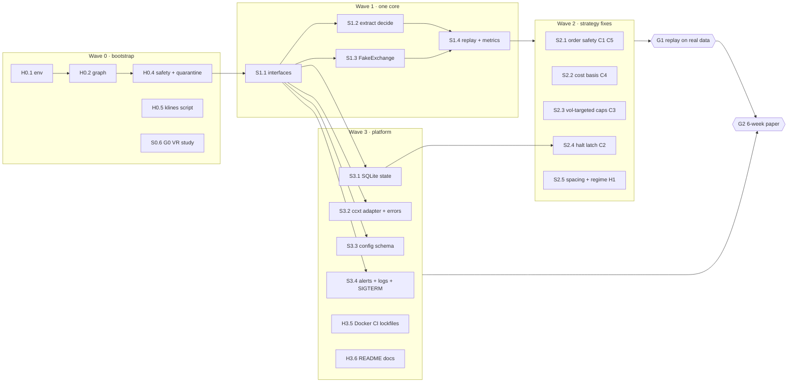

# VolatilityViking: Implementation Plan (multi-agent, token-conservative)

How to execute [`PRODUCTION_PLAN.md`](PRODUCTION_PLAN.md) with Claude agents:
- **graphify** for navigation
- **Sonnet** for writing code
- **Haiku** for setup, CLI work and execution
- **Opus** as orchestrator and reviewer only

---

## 1. Model routing

| Role | Model | Does | Never does |
|---|---|---|---|
| **Orchestrator** | Opus (main session) | Writes work-package (WP) briefs, launches waves, reviews **diffs only**, merges, runs gate decisions | Reads whole files, writes bulk code, runs long CLI loops |
| **Coder** | Sonnet subagent | Anything that needs judgment: refactors, trading/risk logic, stats code, tests, ccxt error handling | Env setup, dependency installs, Docker builds, log reading |
| **Runner** | Haiku subagent | venv/deps/lockfiles, `graphify update`, pytest/ruff/coverage runs and summaries, `git mv` per explicit list, Dockerfile/compose/CI YAML from a spec, data-download scripts, README edits from an outline, fire-drill scripts | Design decisions, trading logic, merge-conflict resolution |

**Rule of thumb:** if the task's correctness can be checked mechanically (a command exits 0, a file matches a spec), give it to Haiku. If it needs reasoning about money, state or statistics, give it to Sonnet.

## 2. Token-saving system

Measured on this repo (2026-11-02, graphify 0.9.101):

| Way of understanding the code | Cost |
|---|---|
| Read every `.py` file | ~339 KB ≈ **85k tokens** |
| `graphify-out/GRAPH_REPORT.md` (god nodes, communities) | 8.7 KB ≈ **2.2k tokens** |
| `graphify explain "process_symbol"` (callers, callees, tests, line numbers) | ≈ **0.4k tokens** |
| `graphify query "…"` (broad BFS) | ~6k tokens; narrow with `--context call` / `--budget` |
| Building/updating the graph (`graphify update .`, AST only) | **0 LLM tokens**, a few seconds |

For calibration, each review agent spent **70k–180k tokens**, most of it exploring the codebase with grep and full reads (quant review 177k, Haiku test run 95k, debate agents 70k–95k).

The rules:

1. **Graph-first navigation.** Agents start with `graphify explain <symbol>` or `graphify query "<q>" --context call --budget 1500`. They read only the line ranges the graph points to. Full-file reads are only allowed for files the agent is rewriting.
2. **Briefs are files, prompts are one line.** Each WP has `docs/impl/wp/WP-xx.md` (≤ 60 lines). The agent prompt is just: *"Read CLAUDE.md and docs/impl/wp/WP-xx.md, then do it."* That keeps the conversation history and review docs out of the agent's context. A brief quotes only the 2–3 lines of a finding it needs (e.g. "C1: buys above market, `async_runner.py:797-804`"), never whole review files.
3. **Test-first acceptance.** Every brief names the failing tests to write first and the command that must go green (`pytest tests/<x> -q && ruff check <paths>`). Done means green. No subjective "looks good".
4. **Output contract.** An agent's final reply is ≤ 120 words: status, files changed, test result line, open questions. Detail goes into the commit message and a `## Result` section appended to the WP file. The orchestrator never reads the transcript.
5. **Bounded retries.** A Sonnet coder gets at most 2 fix cycles on red tests, then stops and reports. Haiku gets 1, then escalates. This stops token spirals.
6. **Haiku reads the logs.** Long pytest, Docker or pip output is summarised by the Haiku runner. Sonnet and Opus only see the summary.
7. **Diff-only review.** Opus reviews `git diff --stat` and then the hunks in risk-critical files (order placement, sizing, halt). Opus doesn't re-read unchanged code.
8. **Keep CLAUDE.md tiny** (≤ 50 lines). It loads into every agent, so every line costs tokens on every call.
9. **Rebuild the graph after every merged wave** (`graphify update .`, free), so the next wave navigates the new structure.
10. **Parallel coders use git worktrees** (`isolation: "worktree"`), so they never read or overwrite each other's half-done work.

## 3. Wave 0: bootstrap (Haiku, ~1 session)

| WP | Model | Task | Done when |
|---|---|---|---|
| H0.1 | Haiku | Python 3.12 venv; `requirements-live.txt` (ccxt pinned exactly, pandas, numpy, pydantic, python-dotenv) and `requirements-dev.txt` (pytest, pytest-asyncio, pytest-cov, ruff, graphifyy==0.9.101); lock with hashes (`uv pip compile --generate-hashes`); `scripts/bootstrap.sh` | `bash scripts/bootstrap.sh && pytest -q` runs (failures expected, no import errors from tooling) |
| H0.2 | Haiku | `graphify update .`; add `make graph`, `make test`, `make lint` targets; confirm `graphify-out/` is gitignored | `make graph` prints the node count |
| O0.3 | Opus | Write `CLAUDE.md` (conventions, graph-first rule, output contract, test commands) and the WP brief template (§7) | File ≤ 50 lines |
| H0.4 | Haiku | Phase 0 safety: `live_mode: false` in `config.json`; anchor `.gitignore` (`/data/`, `/models/`); delete `docs/backtest_results.png`; `git mv` dead code to `legacy/` per an explicit list (`binance_bot.py`, `trader.py`, `portfolio_manager.py`, `momentum_allocator.py`, `src/backtest/*`, `optimizer.py`, `tools/optimizer.py`, `test_live_logic.py`, `test_trading_scenarios.py`, `test_portfolio_manager.py`); add `legacy/` to pytest `norecursedirs` | `pytest -q` collects only live-path tests |
| H0.5 | Haiku | `scripts/fetch_klines.sh`: download 2019–2026 1m ETHUSDT and BTCUSDT monthly zips from `data.binance.vision`, verify checksums, write parquet | Script runs on a machine with Binance access (see §8) |
| S0.6 | Sonnet | **G0 study** `research/g0_variance_ratio.py`: Lo–MacKinlay VR(q) at 5m–4h with heteroskedasticity-robust z and block-bootstrap CI, Hurst/DFA, 4h range vs fee; one-page markdown output | Unit tests on synthetic AR(1) (VR < 1) and GBM (VR ≈ 1) pass |

**Gate G0** (human + Opus): read the one-page result. Fail → switch the roadmap to the carry track and skip Wave 2's grid-specific WPs.

## 4. Work packages and waves



### Wave 1: one strategy core (critical path, mostly serial)

| WP | Model | Depends | Files | Acceptance | Est. tokens |
|---|---|---|---|---|---|
| S1.1 | Sonnet | H0.4 | new `vv/core/types.py` (Snapshot, State, Params, OrderIntent), `vv/core/ports.py` (ExchangeAdapter, StateStore protocols) | mypy/ruff clean; types used by one smoke test | 40–60k |
| S1.2 | Sonnet | S1.1 | `async_runner.py:584-918` → `vv/core/decide.py` split into `pricing.py`, `sizing.py`, `risk.py`, `orders.py` | **Characterization tests first:** record current intents for 6 fixed snapshots, then refactor; traces identical (bugs preserved on purpose; fixed in Wave 2) | 100–150k |
| S1.3 | Sonnet (worktree, parallel with S1.2) | S1.1 | `vv/sim/fake_exchange.py`: virtual clock, 1m matcher, through-tick fills, maker/taker tiers, min-notional/lot rounding, partial fills | Table tests: touch ≠ fill, trade-through = fill, fee math, rounding rejects | 70–100k |
| S1.4 | Sonnet | S1.2, S1.3 | `vv/sim/replay.py`, `vv/sim/metrics.py` (Sharpe, correct Sortino, max DD, time under water, vs buy-and-hold and static grid, bootstrap CI) | Golden-trace test: live `decide()` and replay emit identical intents; metrics unit-tested on known series | 70–100k |
| H1.5 | Haiku | each merge | Run the suite, coverage, `graphify update .`, summarise | ≤ 120-word report | 10–20k each |

### Wave 2: strategy and risk fixes (parallel by module, each in a worktree)

After S1.2, each fix lives in its own module, so five Sonnet agents can run at once without conflicts.

| WP | Fixes | Module | Acceptance (tests written first) | Est. tokens |
|---|---|---|---|---|
| S2.1 | C1 post-only + reject buy ≥ bid; C5 skip tick on any stale/failed fetch; deterministic `clientOrderId` | `orders.py` | No intent ever crosses the book; a failed open-orders fetch yields zero intents; IDs stable across restarts | 50–80k |
| S2.2 | C4 cost-basis ledger from fills; TP ≥ avg_entry × (1 + 2.5 × fee) | `costbasis.py`, `pricing.py` | No TP below breakeven in a falling-EMA scenario | 50–80k |
| S2.3 | C3 cumulative exposure (holdings + resting buys + new); vol-targeted caps clipped at 30–40% / 60% | `sizing.py`, `risk.py` | Exposure never exceeds caps across a 5-level fill sequence | 50–80k |
| S2.4 | C2 halt latch via `StateStore`: −15% equity, −25% per symbol, 3σ, time trip; flatten, exit non-zero, manual `vv resume` | `risk.py`, `cli.py` | Restart-during-halt test: no orders after restart until resume | 60–90k |
| S2.5 | H1: EWMA/HAR spacing = max(2.5 × fee, c × σ); 4h-200-EMA regime rule cancels resting buys; delete RSI panic sell, trailing and unstuck | `pricing.py`, `regime.py` | Replay A/B report (EWMA vs constant span) generated | 60–90k |

Merge order: S2.1 → S2.3 → S2.2 → S2.4 → S2.5. Opus reviews the diffs; Haiku rebases and reruns the suite after each merge.

### Wave 3: production platform (parallel with Wave 2; separate files)

| WP | Model | Task | Acceptance | Est. tokens |
|---|---|---|---|---|
| S3.1 | Sonnet | `vv/infra/state_sqlite.py`: WAL; tables orders, fills, equity_snapshots, kv, events; startup reconciliation vs exchange | Kill-mid-cycle test recovers without duplicate orders | 60–90k |
| S3.2 | Sonnet | `vv/infra/ccxt_adapter.py`: timeouts, error taxonomy (transient→backoff, 429/418→global pause, auth→halt, invalid→cooldown), `adjustForTimeDifference`, startup gates incl. `apiRestrictions.enableWithdrawals == false` | Fault-injection tests per error class | 70–100k |
| S3.3 | Sonnet | `vv/config.py`: pydantic schema, no risk defaults, keep last-good config on bad reload, `VV_LIVE_CONFIRM` required for live | Invalid config → exit 2; bad reload keeps old config | 30–50k |
| S3.4 | Sonnet | JSON logging, Telegram alerts, daily digest, healthchecks.io ping, SIGTERM handler | Alerts fire in tests (HTTP mocked); SIGTERM test exits cleanly | 40–60k |
| H3.5 | Haiku | Multi-stage Dockerfile (py3.12-slim, non-root, healthcheck), compose (`init: true`, log rotation, `restart: on-failure`), systemd unit, GitHub Actions (pytest, ruff, pip-audit, gitleaks), release by image digest; delete `setup_vm.sh` / `migrate_to_cloud.sh` | `docker build` succeeds; CI YAML lints; image runs `--check-config` | 30–50k |
| H3.6 | Haiku | Rewrite README and Docker guide from an Opus outline (what the bot is, how to run testnet and paper, the gates); remove AI/ROI claims | Opus skims the diff | 20–30k |

### Wave 4: paper and staged capital (mostly human time)

| WP | Model | Task |
|---|---|---|
| H4.1 | Haiku | Fire-drill scripts: kill container mid-grid, restart during halt, revoke key (testnet), cut network, fill disk; each prints PASS/FAIL |
| H4.2 | Haiku | Weekly reconciliation report: live fills vs replay per grid level (G2 metric) from SQLite |
| Human | — | Testnet for 1 week, then 6 weeks of tiny live (G2), then capital at 5% → 25% → 100% |

### Wave 5: optional add-ons (only after G2)

S5.1 carry sleeve (Sonnet) and S5.2 bounded ML throttle experiment (Sonnet), each with its own WP brief and gate G3.

## 5. Orchestration loop (per wave)

```
1. Opus     writes WP briefs for the wave (≤60 lines each), commits them.
2. Haiku    H-prep: bootstrap/rebase main, graphify update ., baseline test summary.
3. Sonnet×N launch in parallel (worktrees) with one-line prompts.
            Each: graph-first → write failing tests → implement → green → commit → ≤120-word reply.
4. Haiku    per finished WP: rebase onto main, full suite + ruff, summarise (≤120 words).
5. Opus     review `git diff --stat` + risk-critical hunks; merge or send ≤5 bullet fixes
            back to the same agent (SendMessage resumes it with context; no re-exploration).
6. Haiku    graphify update ., push branch.
7. Opus     gate check (if any) → next wave.
```

Agents that hit a usage limit leave their work in their worktree and WP file. Resume them with `SendMessage` after the reset; don't start a new agent.

## 6. Token budget

Estimates, calibrated on this repo's review agents (70k–180k tokens each without a graph or briefs):

| Wave | Sonnet WPs | Haiku WPs | Sonnet tokens | Haiku tokens | Opus (review) |
|---|---|---|---|---|---|
| 0 | 1 | 4 | ~60k | ~80k | ~30k |
| 1 | 4 | ~4 runs | ~350k | ~60k | ~50k |
| 2 | 5 | ~5 runs | ~350k | ~75k | ~60k |
| 3 | 4 | 2 + runs | ~250k | ~120k | ~40k |
| 4 | 0 | 2 | — | ~50k | ~10k |
| **Total** | **14** | **~17** | **~1.0M** | **~0.4M** | **~0.2M** |

Budget guards:
- **Weekly limits are real.** All five review agents hit the Sonnet/Haiku weekly cap about 5 minutes into this session. Run one wave per limit window. Start big waves just after a reset. Keep at most 3–5 concurrent Sonnet agents.
- **Fallback.** If Sonnet is capped, only the critical path (S1.2, S2.1, S2.4) continues on the main session. Everything else waits.
- **Stop rule.** If a WP blows past 2× its estimate, the agent stops and Opus splits the WP.

## 7. Templates

**WP brief** (`docs/impl/wp/WP-xx.md`):
```markdown
# WP-S2.1 Order safety (C1, C5)
Model: sonnet · Depends: S1.4 · Worktree: yes · Budget: 80k
## Goal
No order intent may cross the book; any failed/stale fetch produces zero intents; deterministic clientOrderId.
## Navigate (graph-first)
graphify explain "decide" ; graphify explain "build_order_intents"
Read only: vv/core/orders.py, tests/core/test_orders.py
## Findings
C1: buys could be placed above market (old async_runner.py:797-804) -> taker fills.
C5: open-orders fetch error returned [] -> duplicate ladder (old :320-327).
## Tests to write first
tests/core/test_orders.py::test_never_crosses_book, ::test_stale_snapshot_no_intents, ::test_client_id_stable
## Done when
pytest tests/core -q && ruff check vv tests   # both green
## Out of scope
Sizing, TP logic, exchange adapter.
## Reply (≤120 words)
status · files changed · test line · open questions
```

**Sonnet coder prompt:**
> Read CLAUDE.md and docs/impl/wp/WP-S2.1.md, then do it. Navigate with graphify before reading files. Tests first. Max 2 fix cycles on red. Commit on success. Reply in ≤120 words per the brief.

**Haiku runner prompt:**
> Read CLAUDE.md. In the worktree at <path>: rebase onto main, run `make test lint`, then `graphify update .`. Reply in ≤120 words: pass/fail counts, first failing test with a one-line cause, and the graph node count. Don't fix code.

## 8. Human tasks (can't be delegated)

- [ ] **Binance data access for G0/G1.** This cloud environment's network policy blocks `data.binance.vision` and `api.binance.com` (proxy 403). Either add `data.binance.vision` under *Allowed domains* in the environment's network settings (environment menu → Edit → Network access; see https://code.claude.com/docs/en/cloud-environments#network-access), or run `scripts/fetch_klines.sh` locally and upload the parquet files.
- [ ] Decide on the missing `src/models` / `src/data` code: recover it from another machine, or confirm deletion.
- [ ] Create a Binance sub-account with a trade-only, IP-whitelisted key (withdrawals off) and a separate read-only key. Create a Telegram bot token and a healthchecks.io check.
- [ ] Gate decisions G0 → G3, and the paper/staged-capital weeks.
